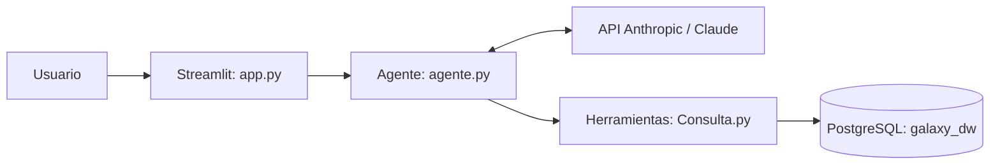

# Agente Minera Galaxy

Asistente conversacional en español para explorar tickets de mantenimiento de una minera ficticia. Integra Claude mediante la API de Anthropic con herramientas Python de consulta a PostgreSQL y una interfaz Streamlit.

**Estado: prototipo en desarrollo.** No se presenta como producto terminado ni como sistema validado para decisiones operacionales. Los datos son sintéticos, según declaración del autor; no representan una empresa minera real.

## Problema y alcance

Permite consultar historial de equipos y estadísticas de tickets mediante lenguaje natural. El modelo selecciona funciones predefinidas; no se le ofrece una herramienta para ejecutar SQL libre.

Funciones implementadas:
- Búsqueda de códigos de equipo, con máximo de 20 resultados.
- Historial de un equipo, con máximo de 100 tickets recientes.
- Agregados por equipo, tipo o mes: cantidad, promedio, mediana, máximo y horas acumuladas; filtros por fechas y tipo.
- Interfaz web, reinicio de conversación y visualización de herramientas utilizadas.
- Cliente de consola y manejo de errores de la API en la interfaz.

## Arquitectura



Las preguntas, el historial enviado y los resultados de herramientas se transmiten a Anthropic durante una conversación. Utilizar exclusivamente datos sintéticos revisados. La aplicación no incluye autenticación ni controles multiusuario.

## Requisitos

- Python 3.12 como entorno local de referencia.
- PostgreSQL accesible, con `galaxy_dw.fact_tickets` y `galaxy_dw.dim_equipo` ya creadas y pobladas.
- Clave propia de la API de Anthropic. Su uso puede generar cargos.
- El modelo está fijado en `MODELO`, dentro de `agente.py`: comprobar acceso antes de ejecutar.

El repositorio no incluye un respaldo, DDL completo ni Docker Compose para recrear la base. El ETL relacionado es Postgres_ETL. Ambos proyectos requieren el esquema existente.

## Instalación en PowerShell

```powershell
python -m venv .venv
.venv\Scripts\python.exe -m pip install -r requirements.txt
Copy-Item .env.example .env
```

Editar `.env` con valores locales. Si ya existe, conservarlo y completar únicamente las variables necesarias. No publicar claves ni contraseñas.

```powershell
.venv\Scripts\python.exe -m streamlit run app.py
# Alternativa: interfaz de consola
.venv\Scripts\python.exe agente.py
```

## Preguntas de ejemplo

- ¿Qué palas hay?
- ¿Qué cinco equipos tienen más tickets?
- ¿Cuál es el historial del código exacto de un equipo?
- ¿Cómo evolucionan los tickets por mes?
- ¿Qué tipo de equipo acumula más horas en enero de 2025?

## Acceso y limitaciones

`Consulta.py` solicita sesiones de solo lectura y un timeout de cinco segundos. Se recomienda además un rol PostgreSQL con permisos SELECT limitados: la sesión de solo lectura no sustituye los privilegios del rol.

Las consultas emplean parámetros y listas permitidas para agrupación y orden. Hay diferencias pendientes entre la normalización de búsqueda e historial y entre el tratamiento de duraciones del historial y los agregados. Las estadísticas no prueban causas ni equivalen automáticamente a fallas de flota: incluyen tickets sin equipo.

Las cantidades y fechas indicadas en el prompt del agente están fijadas manualmente y pueden quedar desactualizadas tras una carga del ETL. No se han verificado contra la base en esta revisión.

## Documentación

- [Diseño y reglas](docs/ARQUITECTURA.md)
- [Plan de pruebas y estado](docs/PRUEBAS.md)
- [Preparación para publicación](docs/PUBLICACION.md)

No se ha agregado una licencia: el autor debe elegir los términos antes de ofrecer permisos de reutilización.
